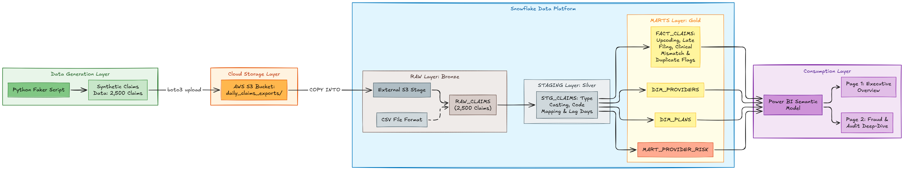

# 🏥 Healthcare Claims Fraud & Preventable Leakage Analytics

An end-to-end cloud data analytics pipeline built using **Python (Faker & Boto3), AWS S3, Snowflake, SQL, and Power BI** to detect medical billing fraud, timely filing violations, and preventable financial leakage across healthcare insurance claims.

---

## 📌 Business Problem & Domain Context
Drawing from my background in **Healthcare Insurance Operations at NTT DATA**, health insurers lose millions annually to undetected billing anomalies—including procedure upcoding, late claim submissions past timely filing limits, clinical diagnosis mismatches, and duplicate billing. 

This project automates the ingestion, cleaning, rule-based anomaly detection, and executive reporting of **2,500 healthcare claims** totaling **$24.57M** in billed charges.

---

## 🏗️ End-to-End Architecture & Tech Stack

1. **Data Generation Layer:** Python (`Faker`) script generating synthetic daily batch claim files (2,500 claims across patients, providers, diagnoses, and procedures) with embedded real-world fraud anomalies.
2. **Cloud Storage Layer (AWS):** Automated upload via `boto3` into an **AWS S3 Bucket (`daily_claims_exports/`)** storing partitioned daily CSV files.
3. **Snowflake Data Platform (Medallion Architecture):**
   * **RAW Layer (Bronze):** Configured an **External S3 Stage** and custom **CSV File Format** to bulk-load raw files into `RAW_CLAIMS` via `COPY INTO`.
   * **STAGING Layer (Silver):** Built `STG_CLAIMS` view for safe type casting (`TRY_TO_NUMBER`, `TRY_TO_DATE`), ICD-10/CPT medical code mapping, and calculating submission lag days (`DATEDIFF`).
   * **MARTS Layer (Gold):** Modeled a Star Schema consisting of **`FACT_CLAIMS`** (enriched with window-function fraud flags), **`DIM_PROVIDERS`**, **`DIM_PLANS`**, and **`MART_PROVIDER_RISK`** for hospital-level scoring.
4. **Consumption Layer (Power BI):** Connected Power BI Desktop to Snowflake (`MARTS` schema) to build a Star Schema semantic model, custom DAX KPIs, and a 2-page interactive dashboard.

---

## 🔍 Fraud & Leakage Detection Rules (`07_marts.sql`)
1. **Procedure Upcoding:** Flags claims billed at more than **2x the median benchmark rate** (`MEDIAN() OVER`) for the exact CPT procedure code (e.g., `$99,000` billed vs. `$23,100` median for Total Knee Arthroplasty).
2. **Timely Filing Violations:** Flags claims submitted more than **90 days** after the service date (`DATEDIFF` lag).
3. **Clinical Diagnosis Mismatches:** Flags high-cost surgical procedures (`CPT 27447`) billed under routine general exam codes (`ICD-10 Z00.00`).
4. **Duplicate Claim Submissions:** Uses `ROW_NUMBER()` partitioned by patient, procedure, and service date to catch repeat billing.

---

## 📊 Key Analytical Findings
* **Total Claims Analyzed:** 2,500 claims (**$24.57M** total billed).
* **Preventable Leakage Identified:** **$12.92M** across **1,162 flagged claims** (**46.48%** overall anomaly rate).
* **Highest-Risk Provider:** **Trinity Health Memorial** generated the highest financial leakage (**$3.65M**, **48.30%** anomaly rate).
* **Volume vs. Quality Insight:** **Metro Health Medical Center** processed the highest claim volume (542 claims) yet maintained the lowest anomaly rate (**44.65%**) and lowest leakage (**$2.09M**).
* **Top Leakage Driver:** **Total Knee Arthroplasty (`27447`)** accounted for **$11.44M** of total preventable leakage.

---

## 🖥️ Dashboard Previews

### Page 1: Executive Claims Overview

### Page 2: Fraud & Audit Deep-Dive

---

## 📂 Repository Structure
* `Generate_data.py` – Python (`Faker`) script generating synthetic daily healthcare claims with embedded fraud scenarios.
* `upload_to_s3.py` – Python (`boto3`) automation script uploading daily CSV exports to AWS S3.
* `daily_claims_exports/` – Sample daily batch CSV claim files (`2,500` total records).
* `AWS/IAM/` – IAM policy and permissions setup for secure S3-to-Snowflake integration.
* `Snowflake/` – SQL scripts (`01_setup.sql` through `07_marts.sql`) covering External S3 Stage setup, `COPY INTO` ingestion, `STAGING` views, and `MARTS` Star Schema tables.
* `POWER BI/` – Power BI `.pbix` report file and exported dashboard preview images.
* `architecture_diagram.png` – End-to-end 4-layer cloud data pipeline architecture diagram.
